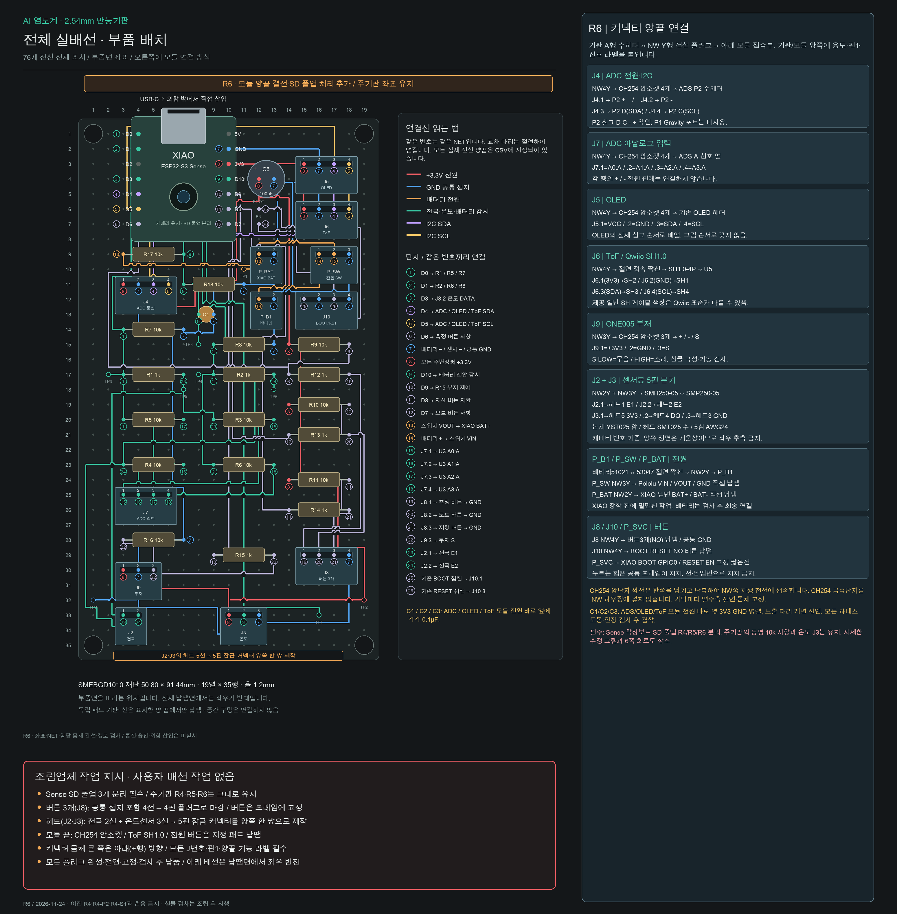

# AI 스마트 염도·부피 측정기

프로젝트의 코드, 원시 측정 기록, 보정표, R6 회로·만능기판 제작 자료, 헤드 CAD, 발표 자료와 사진을 관리합니다. **현재 제작 기준은 R6(2026-11-24)**입니다. R5 조립본은 제작 기준에서 제외하고 용도별 R6 파일로 교체했습니다. 이전 파일은 Git 이력에 남습니다.

## 현재 사용할 파일

| 항목 | 위치 |
|---|---|
| 기기에 올린 펌웨어 | [firmware/SalinityMeterCalibrated](firmware/SalinityMeterCalibrated) |
| 실제 저장된 보정표 | [CalibrationTable.h](firmware/SalinityMeterCalibrated/CalibrationTable.h) |
| 보정 모델과 기준값 | [calibration/current](calibration/current) |
| 보정 완료·확인 기록 | [보정표_저장완료_기록.txt](calibration/current/보정표_저장완료_기록.txt) |
| 해당 펌웨어 바이너리 | [firmware/releases/2026-11-24](firmware/releases/2026-11-24) |
| R6 정식 회로도·페이지별 이미지 | [hardware/schematics/R6](hardware/schematics/R6) |
| R6 만능기판 부품면·납땜면·구멍 좌표·배선표 | [hardware/perfboard/R6](hardware/perfboard/R6) |
| R6 플러그 핀맵·하네스 | [hardware/harness/R6](hardware/harness/R6) |
| R6 부품 구매·제공 목록 | [parts/R6/BOM_R6.csv](parts/R6/BOM_R6.csv) |
| R6 업체 전달·실물 검사표 | [assembly/R6](assembly/R6) |
| R6 자료 검사·규격 출처 | [hardware/validation/R6](hardware/validation/R6) |
| 헤드 CAD·STL 및 발표 자료 | [project-workspace/outputs](project-workspace/outputs) |
| 측정·기구 이력 및 구형 조립본 폐기 목록 | [history](history) |
| 현재 원본·R6 파일 SHA-256 검사 목록 | [SOURCE_MANIFEST.json](SOURCE_MANIFEST.json) |

현재 프로그램은 `SALINITY_CAL_4P_V1`, 기기에서 읽어 확인한 보정표는 `REF_4P_20261124_V2`입니다. `history`의 이전 코드·설명·회로는 당시 자료이며, 현재 버전의 지시로 혼동하지 않아야 합니다.

## R6 제작·조립 기준

- **필수: Sense 카메라/SD 확장보드의 SD 풀업 R4(D9)/R5(D10)/R6(SD_CS)를 실제 리비전 대조 후 개별 분리합니다. J3 절단만으로 완료하지 않습니다. 주기판의 R4/R5/R6 10kΩ와 온도 J3는 유지합니다.**
- 모듈 쪽은 CH254 암15심(ADS P2/입력·OLED·부저) 및 SH1.0 ToF 케이블로 마감합니다. [양끝 연결도](hardware/harness/R6/R6_05_모듈양끝_결선.png)와 [SD 수정도](hardware/validation/R6/R6_06_Sense_SD풀업_수정.png)를 함께 사용합니다.
- 조립 소모품7종을 보충했습니다. 장바구니27품목/67,424원(VAT 포함, 표시 배송비0원), 2026-11-24 화면 기준입니다. 실제 재고·출고일은 판매처 확인 대상입니다.

- SMEBGD1010 에폭시 양면 기판: 홀1.2mm/피치2.54mm/두께1.6mm, 50.80×91.44mm로 재단합니다.
- 기판 커넥터는 NW-A2510: 4P6쌍/3P3쌍/2P3쌍, 압착단자39개 필요(구매50개)입니다.
- 헤드는 SMH250-05/YST025 ↔ SMP250-05/SMT025, 5가닥 모두 AWG24입니다. 1=E1,2=E2,3=GND,4=TEMP_DQ,5=3V3입니다.
- TP0~TP8은 별도 구매품 없이 접근 가능한 검사 패드를 사용합니다. 저항 리드 간격은10.16mm입니다.
- 부품은 사용자가 전량 구매·제공합니다. 업체는 재단·납땜·압착·절연·고정·도통·전원·충전·업로드 검사를 수행합니다.
- R5의 주기판 좌표·76개 배선·부품값·GPIO 배정은 유지합니다. Sense 확장보드 SD 풀업 분리, 모듈 양끝 접속과 추가 소모품을 명시했습니다. 회로도·실배선도·결선표를 함께 사용합니다.
- 104개 접속점과76개 배선을 대조하고 지정 외형·고정물·경로를 검사했습니다. **실물 통전·충전·A0 경로·USB 삽입 검사는 미실시**입니다. [빈 실물 검사표](assembly/R6/09_실물검사기록_미실시.csv)에 결과를 기록합니다.
- XIAO 내장 USB-C는 외함을 열지 않고 직접 꽂도록 기판 상단 밖으로 노출합니다. 닫힌 외함에서 완전 삽입·충전·업로드 검사가 필요하며, **최종 외함 생산용 CAD는 확정되지 않았습니다.**
- OLED·버튼·부저·ToF·Wi-Fi 통합과 무선 업데이트는 후속 펌웨어 작업입니다. 현재 USB 측정용 코드의 미구현 기능을 배선 오류로 판단하지 않습니다.



## 확인된 상태

- XIAO ESP32-S3 Sense, ADS1115와 DS18B20을 사용합니다. 기존 헤드를 재사용하며, 실물 금속 봉의 돌출 길이는 약 10mm입니다.
- A0 측정 경로의 간헐적인 이상이 물 밖의 1kΩ 기준 부하에서도 관찰됐습니다. 물리적 원인을 확정·수리했다고 주장하지 않습니다. 현재 계산은 A0 값에 의존하지 않습니다.
- R1=R2=1kΩ인 설계에서 `C = 200 × (A1-A3)/(A2-A3)`로 전류 응답을 구합니다. A0 변환은 기존 샘플 시점을 유지하기 위해 남아 있지만 값은 계산에 사용하지 않습니다.
- `C`는 염도 %가 아닙니다. 세 획득의 중앙값을 구하고, 비교용 염도계의 0.5·0.6·1.1·2.0% 기준에 맞춘 단조 구간선형 표로 추정값을 만듭니다.
- 0.5·1.1%는 기존 원시 기록을 재계산한 기준입니다. 0.6·2.0%는 새 전류 응답으로 읽었고, 2.0% 상한점은 후속 확인값으로 한 번 조정했습니다.
- 최종 확인은 **같은 2.0% 기준액에서 2.01%**였습니다. 입력이 상한점보다 조금 높아 `ABOVE_REFERENCE_SPAN` 표시도 동반했습니다. 이는 동일 기준액의 반복 확인이며 독립적인 전체 구간 정확도 시험은 아닙니다.
- 온도 보상은 미적용입니다. 기준마다 기록 온도·시점이 다릅니다. 다른 온도·음식 성분·침수 조건에서의 정확도와 전체 OLED/ToF/버튼/배터리 통합 동작까지 검증한 것은 아닙니다.

## 하드웨어와 측정 연결

| XIAO/노드 | 연결 |
|---|---|
| D0 / GPIO1 | R1 1kΩ → 전극 E1 |
| D1 / GPIO2 | R2 1kΩ → 전극 E2 |
| E1 / E2 | 각각 R3 / R4 10kΩ → ADS A0:A / A1:A |
| D0 / D1 구동 노드 | 각각 R5 / R6 10kΩ → ADS A2:A / A3:A |
| D0 / D1 구동 노드 | 각각 R7 / R8 10kΩ → GND |
| D3 / GPIO4 | DS18B20 DATA, 노랑선 |
| D4 / GPIO5 | I2C SDA |
| D5 / GPIO6 | I2C SCL |
| D6 / GPIO43 | 측정 버튼 KEY1 |
| D7 / GPIO44 | 모드 버튼 KEY2 |
| D8 / GPIO7 | 저장 버튼 KEY3 / SD 미사용 |
| D9 / GPIO8 | 부저 제어 / SD 미사용 |
| D10 / GPIO9 | R17/R18 분압·C4를 통한 배터리 감시 / SD 미사용 |
| 3V3 / GND | 센서 공통 전원·접지 |

ADS1115는 주소 `0x48`, 3.3V 전원, I2C 100kHz, `GAIN_ONE`, 860SPS를 사용합니다. DFR0553의 `A0:A`는 A0 행의 **A 신호 단자**이며, 같은 행의 `+/-` 전원 단자와 구별해야 합니다. DS18B20은 빨강=VDD, 검정=GND, 노랑=DATA입니다.

현재 조립 자료는 R6만 사용합니다. R6의 자료 검사는 전체 장치의 실물 조립·충전·정확도 검증을 뜻하지 않습니다. SD카드 제거와 함께 확장보드 SD 풀업을 개별 분리하고, 공유 SPI를 초기화하지 않습니다.

## 펌웨어 빌드와 명령

실제 사용한 환경:

- Arduino CLI 1.6.0
- ESP32 Arduino core 3.3.12
- Adafruit ADS1X15 2.6.2
- Adafruit BusIO 1.17.4
- OneWire 2.3.8
- DallasTemperature 4.0.5

해당 보드 패키지와 라이브러리가 설치된 환경에서:

```sh
arduino-cli compile --fqbn esp32:esp32:XIAO_ESP32S3:USBMode=hwcdc,CDCOnBoot=default firmware/SalinityMeterCalibrated
arduino-cli upload --fqbn esp32:esp32:XIAO_ESP32S3:USBMode=hwcdc,CDCOnBoot=default --port <PORT> firmware/SalinityMeterCalibrated
```

USB 시리얼은 115200 baud입니다.

| 명령 | 동작 |
|---|---|
| `m` | 세 획득의 중앙값으로 보정 염도 추정 출력 |
| `k` | 보정 전 전류 응답 한 획득 |
| `p` | 기기에 저장된 네 보정점 출력 |
| `t` | 온도만 읽기 |

`m`은 중간에 `CURRENT_RESULT` 세 줄을 내보낸 뒤 **`SALINITY_RESULT`**를 출력합니다. 첫 중간 결과에서 읽기를 끝내면 안 됩니다. 명령이 없거나 측정이 끝나면 구동 핀은 INPUT으로 해제합니다.

## 자료 구분

`history`에는 측정 원시 로그·보정·진단·헤드 기구 이력을 보존합니다. 구형 회로·조립 전달본은 현재 파일 목록에서 제거했으며 [폐기 목록](history/retired-assembly/retired_2026-11-24.json)에 이전 경로와 Git blob SHA를 기록했습니다. 과거 원본은 Git 커밋 이력에 남아 있습니다. [최초 반입 매니페스트](history/import/2026-11-24/SOURCE_MANIFEST.json)는 당시 기록 원본입니다. 일부 제작 스크립트·설정에는 당시 PC의 절대 경로가 들어 있습니다. 현재 펌웨어는 위 독립된 폴더에서 빌드할 수 있지만, 과거 문서·이미지 생성 스크립트는 경로와 외부 실행환경을 조정해야 할 수 있습니다.

직접 만든 소스·모델·문서·측정 자료와 프로젝트별 빌드 산출물은 포함했습니다. `node_modules`, Arduino/ESP32 컴파일러 설치본, 라이브러리/오브젝트 캐시, 기존 `.git` 내부와 OS 임시 파일은 포함하지 않았습니다. 원래 전달된 초기 클립보드 도식 한 장은 현재 디스크에 없어 `unavailable_sources`에 기록했습니다.

관련 제조사 자료와 외부 라이브러리는 각 원저작자의 조건을 따릅니다. 이 저장소에 별도의 오픈소스 라이선스를 새로 부여하지 않았습니다.

복사본의 원본 일치 여부는 다음으로 확인할 수 있습니다:

```sh
python tools/verify_manifest.py
```

