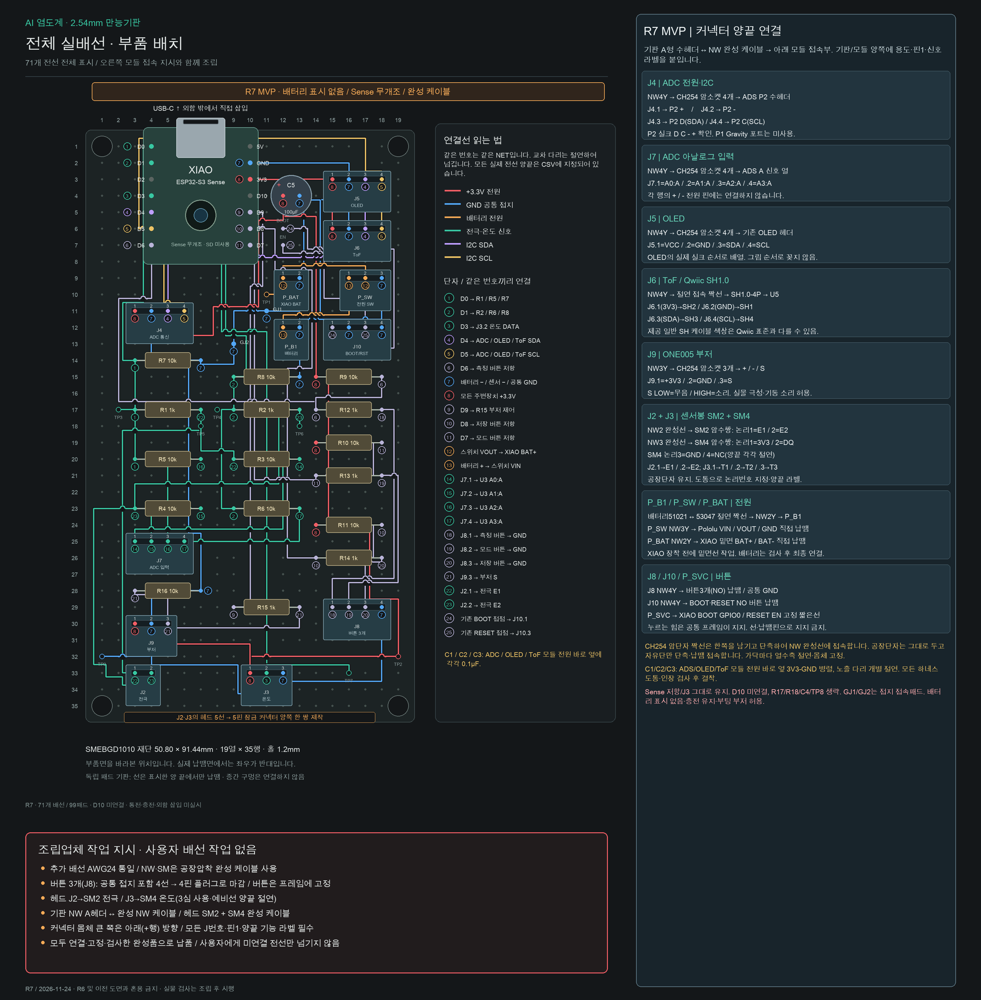

# AI 스마트 염도·부피 측정기

현재 배선 기준은 **R7 MVP**, 펌웨어·조립 보완은 **R7.1 (2026-11-24)**입니다. 배터리 잔량 표시는 생략하고 Sense 확장보드를 개조하지 않습니다. R6 조립 파일은 현재 폴더에서 폐기했으며 Git 이력에 남습니다.

## 현재 제작 파일

| 항목 | 위치 |
|---|---|
| 정식 회로도 5쪽·페이지 이미지 | [hardware/schematics/R7](hardware/schematics/R7) |
| 부품면·납땜면 배선도·좌표·71개 전선 | [hardware/perfboard/R7](hardware/perfboard/R7) |
| 커넥터 양끝 결선·헤드 SM2/SM4·핀맵 | [hardware/harness/R7](hardware/harness/R7) |
| 구매/보유 부품표 | [parts/R7/BOM_R7.csv](parts/R7/BOM_R7.csv) |
| 구매목록·장바구니 수량 | [parts/R7](parts/R7) |
| 조립 지시·USB 접근 단면·빈 검사표 | [assembly/R7](assembly/R7) |
| 자료 검사 결과·규격 출처 | [hardware/validation/R7](hardware/validation/R7) |
| 현재 검사용 펌웨어·보정표 | [firmware/SalinityMeterCalibrated](firmware/SalinityMeterCalibrated) |
| 보정 모델·기준값 | [calibration/current](calibration/current) |
| 기존 실측/기구/CAD 이력 | [project-workspace/outputs](project-workspace/outputs), [history](history) |

## R7 MVP 조립 기준

- **R7.1 펌웨어는 실제 재빌드 완료. [소스·새 바이너리·빌드기록](firmware/releases/R7.1-2026-11-24)을 사용합니다. 이전 2026-11-24 바이너리는 현행 폴더에서 제외하고 Git 이력에 남겼습니다.**
- **NW 완성 케이블은 절단·납땜 전 제공 A헤더와 실제 결합·잠금·각심 도통을 확인합니다.** 공급사 제조사별 외형 변경 안내 때문에 계열명만으로 결합 합격 판정하지 않습니다.
- **DS18B20 기존 수축튜브 안의 내장4.7kΩ 풀업과 이음부를 보존합니다.** 해당 구간 바깥 여유선에서 SM4 완성 케이블을 이어 붙입니다.

- **Sense 확장보드의 저항과 J3/JP3는 그대로 유지합니다. 제거·절단 작업은 하지 않습니다.** SD카드를 넣지 않고 SD/공유 SPI를 초기화하지 않습니다.
- 새 만능기판에는 R17/R18/C4/TP8을 실장하지 않습니다. **D10은 NC 미연결**입니다. 배터리 잔량 표시만 생략하며 내장 USB-C 충전·배터리 보호는 유지합니다.
- 접지 가지가 끊기지 않도록 **GJ1(11-11)/GJ2(09-13)** 납땜 접속패드를 남깁니다. 별도 부품은 필요 없습니다. 주기판은 **71개 전선/99패드**, 검사점 TP0~TP7 8개입니다. 전선 ID의 빈 번호는 삭제된 배선을 뜻합니다.
- 부팅·리셋 순간 부저음은 허용합니다. 평상시 ONE005의 LOW 무음/HIGH 소리는 조립 검사합니다.
- 기판측 NW-A2510 A헤더는 4P6개/3P3개/2P3개. 상대는 **NW3-5051-04/03/02 공장 압착 완성선**입니다. 별도 압착단자·압착공구는 구매하지 않습니다.
- 헤드는 **SM2 완성 암수쌍(전극) + SM4 완성 암수쌍(온도)**입니다. J2.1→SM2 논리1 E1/.2→논리2 E2. J3.1→SM4 논리1 3V3/.2→논리2 DQ/.3→논리3 GND. SM4 논리4는 예비선으로 양끝 각각 절연합니다. 번호는 결착 도통 후 지정·라벨하며 제조사 캐비티번호나 색상으로 추측하지 않습니다.
- ADS는 기존 DFR0553 재사용. 통신은 **P2 +,-,D,C** 4핀 수헤더, 아날로그는 A0~A3의 A 신호열입니다. CH254 암15심(통신4+입력4+OLED4+부저3), ToF는 SH1.0 케이블을 사용합니다. Gravity P1은 미사용입니다.
- 추가 배선은 **AWG24 검정20m 한 롤**로 통일합니다. 공장 NW/CH254/SH/SM 케이블의 굵기와 단자는 그대로 두고 자유단만 단축·납땜·개별 열수축 절연합니다.
- 1kΩ6개/10kΩ10개/100nF3개/100uF1개 실장. 구매10/20/10/10개는 소모 여분 포함 유지. 기존 모듈·배터리·버튼 재사용, M2/M3 고정키트 유지.
- 장바구니 **23종, 상품+VAT 54,411원**(2026-11-24 확인). 현재 퀵(착불)이 선택되어 배송비0원으로 표시되므로 실제 배송비는 별도입니다. 표시납기1~4영업일은 실재고·출고 보장이 아닙니다.
- 기판은 SMEBGD1010 피치2.54/홀1.2/두께1.6mm, 재단50.80×91.44mm(19×35홀). M3 체결물외경≤6.5mm, 납땜면아래유효여유≥5mm. AWG24의 실제 피복외경·교차 높이·납땜부/케이스 여유는 조립 시 확인합니다.
- OLED와 버튼은 공통 전면 프레임 고정. XIAO 내장 USB-C를 기판 가장자리에서 외함 밖으로 직접 꽂도록 노출합니다. 실물 케이블 몰드 기준 개구·진입경로를 확보하고 외함 닫힘 상태 완전삽입/충전/업로드를 시험합니다. **최종 외함 생산 CAD와 실물 통전·충전·USB 끼움 검증은 미완료**입니다.
- 현재 펌웨어에는 원래 배터리 표시/측정 코드가 없습니다. 이번 펌웨어 변경은 R7 주석과 setup의 `pinMode(D9, OUTPUT)` 후 `digitalWrite(D9, LOW)` 초기화2줄입니다. 부팅 후 평상시 부저를 무음으로 두며 측정 동작과 보정표는 그대로입니다. ESP32 코어3.3.12로 실제 빌드를 통과했습니다. USB 장치 미연결로 기기 업로드·부저 실물 검사는 미실시입니다. OLED/ToF/버튼/부저/Wi-Fi 통합은 후속 개발입니다.



## 확인된 상태

- XIAO ESP32-S3 Sense, ADS1115와 DS18B20을 사용합니다. 기존 헤드를 재사용하며, 실물 금속 봉의 돌출 길이는 약 10mm입니다.
- A0 측정 경로의 간헐적인 이상이 물 밖의 1kΩ 기준 부하에서도 관찰됐습니다. 물리적 원인을 확정·수리했다고 주장하지 않습니다. 현재 계산은 A0 값에 의존하지 않습니다.
- R1=R2=1kΩ인 설계에서 `C = 200 × (A1-A3)/(A2-A3)`로 전류 응답을 구합니다. A0 변환은 기존 샘플 시점을 유지하기 위해 남아 있지만 값은 계산에 사용하지 않습니다.
- `C`는 염도 %가 아닙니다. 세 획득의 중앙값을 구하고, 비교용 염도계의 0.5·0.6·1.1·2.0% 기준에 맞춘 단조 구간선형 표로 추정값을 만듭니다.
- 0.5·1.1%는 기존 원시 기록을 재계산한 기준입니다. 0.6·2.0%는 새 전류 응답으로 읽었고, 2.0% 상한점은 후속 확인값으로 한 번 조정했습니다.
- 최종 확인은 **같은 2.0% 기준액에서 2.01%**였습니다. 입력이 상한점보다 조금 높아 `ABOVE_REFERENCE_SPAN` 표시도 동반했습니다. 이는 동일 기준액의 반복 확인이며 독립적인 전체 구간 정확도 시험은 아닙니다.
- 온도 보상은 미적용입니다. 기준마다 기록 온도·시점이 다릅니다. 다른 온도·음식 성분·침수 조건에서의 정확도와 전체 OLED/ToF/버튼/배터리 통합 동작까지 검증한 것은 아닙니다.

## 하드웨어와 측정 연결

| XIAO/노드 | 연결 |
|---|---|
| D0 / GPIO1 | R1 1kΩ → 전극 E1 |
| D1 / GPIO2 | R2 1kΩ → 전극 E2 |
| E1 / E2 | 각각 R3 / R4 10kΩ → ADS A0:A / A1:A |
| D0 / D1 구동 노드 | 각각 R5 / R6 10kΩ → ADS A2:A / A3:A |
| D0 / D1 구동 노드 | 각각 R7 / R8 10kΩ → GND |
| D3 / GPIO4 | DS18B20 DATA, 노랑선 |
| D4 / GPIO5 | I2C SDA |
| D5 / GPIO6 | I2C SCL |
| D6 / GPIO43 | 측정 버튼 KEY1 |
| D7 / GPIO44 | 모드 버튼 KEY2 |
| D8 / GPIO7 | 저장 버튼 KEY3 / SD 미사용 |
| D9 / GPIO8 | 부저 제어 / SD 미사용 |
| D10 / GPIO9 | NC 미연결 / 배터리 잔량 표시 생략 |
| 3V3 / GND | 센서 공통 전원·접지 |

ADS1115는 주소 `0x48`, 3.3V 전원, I2C 100kHz, `GAIN_ONE`, 860SPS를 사용합니다. DFR0553의 `A0:A`는 A0 행의 **A 신호 단자**이며, 같은 행의 `+/-` 전원 단자와 구별해야 합니다. DS18B20은 빨강=VDD, 검정=GND, 노랑=DATA입니다.

현재 조립 자료는 R7만 사용합니다. R7의 자료 검사는 전체 장치의 실물 조립·충전·정확도 검증을 뜻하지 않습니다. Sense 확장보드는 저항/J3 수정 없이 유지하고 SD카드 및 공유 SPI는 사용하지 않습니다. 부팅 부저음은 MVP에서 허용합니다.

## 펌웨어 빌드와 명령

실제 사용한 환경:

- Arduino CLI 1.6.0
- ESP32 Arduino core 3.3.12
- Adafruit ADS1X15 2.6.2
- Adafruit BusIO 1.17.4
- OneWire 2.3.8
- DallasTemperature 4.0.5

해당 보드 패키지와 라이브러리가 설치된 환경에서:

```sh
arduino-cli compile --fqbn esp32:esp32:XIAO_ESP32S3:USBMode=hwcdc,CDCOnBoot=default firmware/SalinityMeterCalibrated
arduino-cli upload --fqbn esp32:esp32:XIAO_ESP32S3:USBMode=hwcdc,CDCOnBoot=default --port <PORT> firmware/SalinityMeterCalibrated
```

USB 시리얼은 115200 baud입니다.

| 명령 | 동작 |
|---|---|
| `m` | 세 획득의 중앙값으로 보정 염도 추정 출력 |
| `k` | 보정 전 전류 응답 한 획득 |
| `p` | 기기에 저장된 네 보정점 출력 |
| `t` | 온도만 읽기 |

`m`은 중간에 `CURRENT_RESULT` 세 줄을 내보낸 뒤 **`SALINITY_RESULT`**를 출력합니다. 첫 중간 결과에서 읽기를 끝내면 안 됩니다. 명령이 없거나 측정이 끝나면 구동 핀은 INPUT으로 해제합니다.

## 자료 구분

`history`에는 측정 원시 로그·보정·진단·헤드 기구 이력을 보존합니다. 구형 회로·조립 전달본은 현재 파일 목록에서 제거했으며 [폐기 목록](history/retired-assembly/retired_2026-11-24.json)에 이전 경로와 Git blob SHA를 기록했습니다. 과거 원본은 Git 커밋 이력에 남아 있습니다. [최초 반입 매니페스트](history/import/2026-11-24/SOURCE_MANIFEST.json)는 당시 기록 원본입니다. 일부 제작 스크립트·설정에는 당시 PC의 절대 경로가 들어 있습니다. 현재 펌웨어는 위 독립된 폴더에서 빌드할 수 있지만, 과거 문서·이미지 생성 스크립트는 경로와 외부 실행환경을 조정해야 할 수 있습니다.

직접 만든 소스·모델·문서·측정 자료와 프로젝트별 빌드 산출물은 포함했습니다. `node_modules`, Arduino/ESP32 컴파일러 설치본, 라이브러리/오브젝트 캐시, 기존 `.git` 내부와 OS 임시 파일은 포함하지 않았습니다. 원래 전달된 초기 클립보드 도식 한 장은 현재 디스크에 없어 `unavailable_sources`에 기록했습니다.

관련 제조사 자료와 외부 라이브러리는 각 원저작자의 조건을 따릅니다. 이 저장소에 별도의 오픈소스 라이선스를 새로 부여하지 않았습니다.

복사본의 원본 일치 여부는 다음으로 확인할 수 있습니다:

```sh
python tools/verify_manifest.py
```

